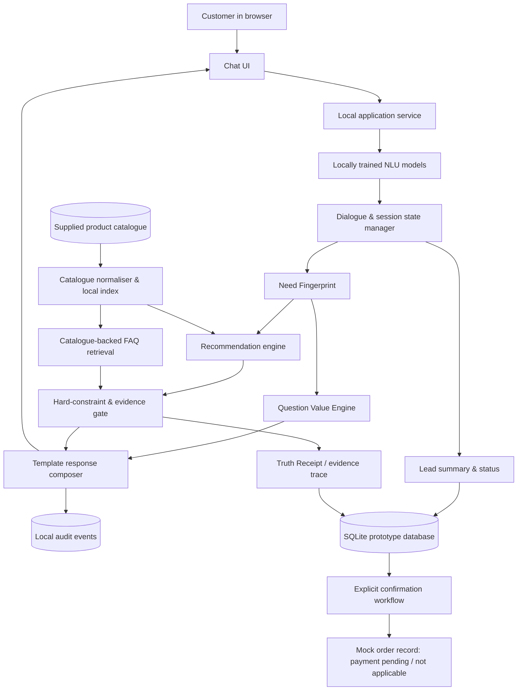
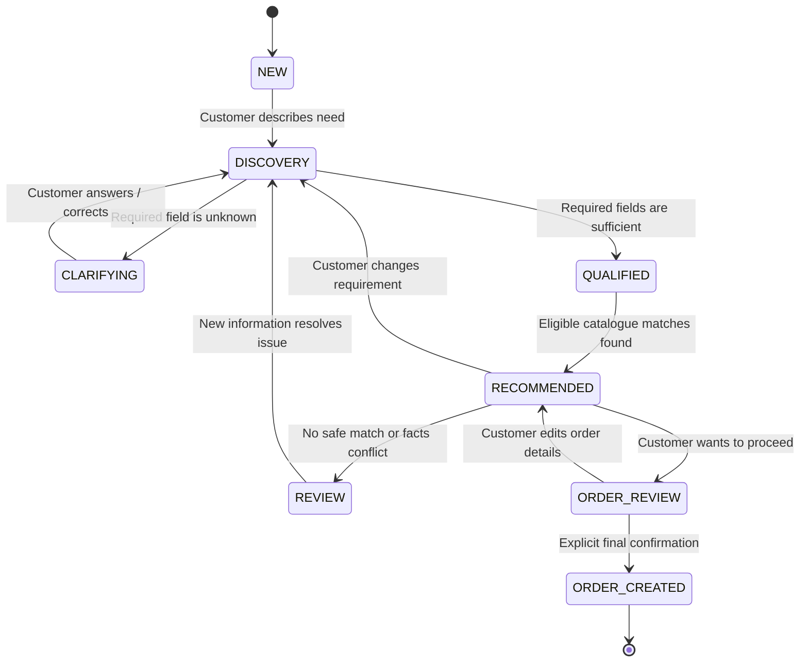

# AgriSutra — The Evidence-First AI Sales Agent

> **A 24-hour hackathon prototype for Challenge 01: AI Text-Based Sales Agent**  
> Built for the SGB Agro Industries Pvt. Ltd. challenge brief  
> **Core promise:** *No recommendation without a reason. No product claim without evidence. No order without explicit consent.*

AgriSutra is a catalogue-grounded sales assistant that turns incoming text enquiries into structured customer needs, explainable product matches, and a consent-confirmed **mock order**. Instead of pretending to be an all-knowing chatbot, it knows exactly which facts it can prove, which requirement is still missing, and when it should ask a question or escalate.

This README describes a proposed solution architecture and implementation plan. The challenge brief's common rules say that existing LLMs and AI speech/service APIs are not permitted and that model training is required. Although the individual text challenge mentions existing AI APIs as permitted, this design follows the **stricter common rule**: models are trained locally for the prototype, and no external LLM or hosted AI API is required.

---

## 1. The problem we are solving

The challenge brief describes approximately **200–250 product enquiries per day** arriving through Meta ads and WhatsApp. Product details are partly automated, but staff still handle questions, qualify leads, compare products, and move interested customers towards an order. The result is repetitive work and a risk of inconsistent answers.

AgriSutra addresses the text-based track's key requirements:

- Natural, multi-turn conversations that retain context.
- Requirement discovery before making a recommendation.
- Accurate product details, prices, applications, limitations, and comparisons grounded in the supplied catalogue.
- Recovery when customers correct themselves, change a requirement, ask an unfamiliar question, or provide contradictory information.
- Explicit purchase confirmation followed by a simulated order record—not a payment or real order.
- A readable conversation summary and current lead status.

**Important data boundary:** the actual shared product catalogue was not included in the challenge brief supplied for this README. The system must load the organisers' catalogue at runtime; this project does not invent SGB Agro product names, prices, specifications, or availability.

---

## 2. The big idea: stop building a chatbot; build a sales decision engine

Most basic demos take a customer message, send it to a language model, and display a plausible reply. That approach is impressive until the customer asks for a product limitation, changes a key requirement, or asks about a fact missing from the catalogue.

AgriSutra uses a different loop:

1. **Understand** the customer's message with locally trained intent and entity models.
2. **Update** a structured, editable customer-need profile.
3. **Prove** which catalogue facts apply to the current question.
4. **Eliminate** products that fail mandatory requirements.
5. **Ask** the most useful next question when the available information cannot support a safe recommendation.
6. **Recommend** only candidates that survive the rules, with a visible evidence trail and limitations.
7. **Confirm** the exact product, quantity, and order details before creating a mock order.

The system is not rewarded for saying more. It is rewarded for making the next decision correctly.

### Signature innovation: the Proof-Carrying Recommendation

Every recommendation is packaged with a **Truth Receipt** containing:

- The catalogue record and field(s) that support each stated fact.
- Which customer requirements match the product.
- Which requirements are mandatory and have been checked.
- Known limitations and catalogue fields that are missing.
- The reason the product was selected over alternatives.
- The facts that would change the recommendation if the customer changed their mind.

In the UI, a customer sees a clear answer; a judge or operator can expand the receipt to inspect the underlying evidence. This makes explainability a product feature, not a paragraph added after the fact.

---

## 3. What makes AgriSutra different

### 3.1 The Need Fingerprint

A conversation is continuously converted into a compact, structured profile called the **Need Fingerprint**. It contains known requirements, preferences, unknowns, confidence, and the source of each value.

Example (illustrative schema only):

```json
{
  "session_id": "demo-session-001",
  "requirements": {
    "intended_use": {"value": "customer-stated use", "status": "known", "source": "message-4"},
    "budget": {"value": 2500, "unit": "INR", "status": "known", "source": "message-6"},
    "mandatory_feature": {"value": null, "status": "unknown", "source": null}
  },
  "preferences": {"delivery_speed": "preferred, not mandatory"},
  "contradictions": [],
  "last_updated_by": "message-6"
}
```

The values above are placeholders to illustrate structure, **not actual product or customer data**. The real fields are derived from the supplied catalogue and the questions needed to distinguish its products. The agent does not ask every customer a fixed questionnaire: it asks only about information that could change the recommendation.

### 3.2 The Question Value Engine

Instead of asking generic follow-ups, AgriSutra evaluates what it still does not know and selects a question that is likely to reduce uncertainty most.

For example, if three products remain plausible but only one supports a particular application, asking about the intended application may eliminate two candidates. Asking the customer's colour preference would be pointless if colour does not affect compatibility.

Prototype strategy:

1. List the candidate products that currently survive hard constraints.
2. Find missing requirement fields that distinguish those candidates.
3. Score each possible question by how much it may split the candidate set, weighted by business importance and question burden.
4. Ask one short question, then recompute after the answer.

This is a practical, explainable approximation to information gain—not a claim that the prototype uses a sophisticated probabilistic model.

### 3.3 Hard-Constraint Gate + Soft-Preference Ranking

A beautiful weighted score must never allow a product to win when it violates a non-negotiable requirement.

- **Hard constraints:** requirements that must be satisfied, such as an explicitly stated compatibility or a budget ceiling when treated as absolute. A product with a known conflict is excluded.
- **Soft preferences:** desirable factors that help rank eligible candidates.
- **Unknown facts:** cannot be treated as a match. If a required fact is absent, the agent asks, labels the result tentative, or escalates.

Only after the hard-constraint gate does the ranker compare the remaining candidates. Every ranking is explainable in terms of matched preferences and catalogue facts. Fit scores are decision aids, not guarantees of real-world outcomes.

### 3.4 Change-of-Mind Recalculation

When a customer says, “Actually, my budget is lower,” or corrects an earlier requirement, AgriSutra updates the specific field, marks the previous value as superseded, and recomputes the candidate set. It does **not** keep recommending a product that depended on the old assumption.

If the correction conflicts with something else the customer said, the agent asks for clarification instead of quietly choosing whichever value is convenient.

### 3.5 Truthful Uncertainty

Catalogue facts are separated from model predictions. A locally trained model can classify the message; it cannot create product specifications.

- Known fact → answer with a catalogue-backed value.
- Missing fact → say that the supplied information does not establish it.
- Ambiguous customer need → ask a focused question.
- Conflicting product or customer data → disclose the conflict and pause the recommendation.
- Out-of-scope or low-confidence case → offer human review.

The architecture reduces unsupported product claims, but no prototype should be advertised as mathematically incapable of making mistakes. The demo should measure factual grounding and failure recovery explicitly.

### 3.6 Privacy by Session Boundary

Each demo customer has an isolated session and lead record. Retrieval is scoped to the active session and approved catalogue data. Customer A's messages must never appear in Customer B's summary or mock order. The hackathon uses simulated data; production deployment would need a separate security, consent, retention, and access-control review.

---

## 4. Scope and non-goals

### In scope

- Browser-based text chat.
- Locally trained intent classification and requirement extraction.
- Catalogue search, filtering, comparisons, and evidence-linked replies.
- Multi-turn state management and requirement changes.
- Lead qualification, conversation summary, and status display.
- Mock order creation only after explicit confirmation.
- A judge/demo panel showing the Need Fingerprint, product evidence, state transitions, and fallback reasons.

### Explicitly out of scope for this prototype

- Live WhatsApp or Meta integration.
- Real CRM connectivity or outbound messaging.
- Payment processing, UPI, finance verification, or a real sale.
- Claims about inventory beyond the catalogue's declared availability assumptions.
- Unverified product facts, fabricated discounts, or invented delivery promises.
- A general-purpose pretrained LLM or hosted AI API.

---

## 5. System architecture



### Component responsibilities

| Component | Responsibility | Key safeguard |
|---|---|---|
| Chat UI | Multi-turn messages, product comparison, confirmation controls | Never disguises a recommendation as an order confirmation |
| Local NLU | Classifies intents and extracts requirement candidates | Confidence threshold and unknown-intent fallback |
| Dialogue manager | Maintains state and decides the next permitted action | Explicit state transitions; corrections trigger recalculation |
| Need Fingerprint | Stores current requirements, preferences, unknowns, and provenance | Values retain source message and current/superseded status |
| Catalogue normaliser | Validates and indexes the organisers' catalogue | Missing fields stay missing; no synthetic product facts |
| Recommendation engine | Applies hard constraints, then ranks soft matches | A soft score cannot override a hard conflict |
| Evidence gate | Checks every product claim against catalogue fields | Unsupported claim is blocked or rewritten as unknown |
| Response composer | Produces natural replies from safe templates and verified values | No free-form external LLM generation |
| Lead/order service | Tracks lead status and creates mock orders | Order requires explicit, recorded confirmation |
| Audit log | Records decisions, evidence IDs, and state changes | Enables judge-visible debugging without cross-session leakage |

---

## 6. Conversation and sales workflow



### Turn-by-turn decision loop

1. **Receive message.** Attach it to the active session and assign a message ID.
2. **Understand intent.** Predict a supported intent such as product discovery, product detail, comparison, objection, correction, order intent, confirmation, cancellation, or human help.
3. **Extract entities and constraints.** Detect catalogue product names, prices/budgets, quantities, use cases, preferences, and negation/correction cues.
4. **Update profile.** Record new values with provenance; do not silently discard conflicting values.
5. **Check what is missing.** Determine whether the catalogue and customer profile support a recommendation.
6. **Ask or decide.** Ask the highest-value clarifying question, show a comparison, recommend eligible products, or escalate.
7. **Ground the response.** Compose factual sentences only from verified catalogue fields and attach a Truth Receipt.
8. **Update lead state.** Show a concise summary, known needs, unresolved questions, recommended items, and current status.
9. **Order safely.** Preview the mock order, ask for explicit confirmation, then create the mock record with payment status `PENDING` or `NOT_APPLICABLE`.

### Correction example

**Customer:** “I need a product under ₹X.”  
**Agent:** “I’ll prioritise products at or below that budget. What is the intended application?”  
**Customer:** “Actually, the budget is lower now.”  
**Agent:** “Thanks for correcting that. I’ve updated your budget and will recalculate the matches. The earlier recommendation may no longer fit.”

`₹X` is deliberately a placeholder; the example does not assert a real price or catalogue item.

---

## 7. Locally trained intelligence — no pretrained LLM required

The brief's common rules require training and prohibit existing LLM, speech, and AI-service APIs. AgriSutra is designed around small, auditable models that can be trained on the hackathon machine and whose results are paired with deterministic business rules.

### 7.1 Intent classifier

**Suggested baseline:** word and character n-gram TF-IDF features with a locally trained logistic regression or linear SVM classifier.

Example intent labels:

- `DISCOVER_PRODUCT`
- `ASK_PRODUCT_FACT`
- `COMPARE_PRODUCTS`
- `STATE_REQUIREMENT`
- `CORRECT_REQUIREMENT`
- `RAISE_OBJECTION`
- `EXPRESS_BUYING_INTENT`
- `CONFIRM_ORDER`
- `CANCEL_OR_STOP`
- `ASK_FOR_HUMAN`
- `UNKNOWN`

Start with reviewed, hand-labelled examples. Augment only with transparent, rule-based paraphrase variations and test them for label correctness. Keep a held-out test set made from phrasings not used during training. Do not report model accuracy until it has actually been measured.

### 7.2 Requirement and entity extraction

Use a hybrid of:

- Catalogue-derived aliases for product names and categories.
- Unit-aware regular expressions for numeric quantities, currency, and percentages where relevant.
- Negation and correction patterns such as “not X,” “instead,” “actually,” and “change that to.”
- A locally trained token classifier for entities that the labelled data supports.
- A validation layer that checks extracted values against the catalogue's expected types and allowed ranges.

A detected number is not automatically a budget; context decides whether it is price, quantity, area, or another field. If the parser cannot distinguish the meaning safely, the agent asks.

### 7.3 Catalogue-backed FAQ matching

For the prototype, index only supplied FAQ entries and catalogue descriptions using a local lexical retrieval method (for example, TF-IDF cosine similarity or BM25 implemented locally). Retrieve candidate passages, then verify that they contain the requested fact and meet a minimum similarity/field-match threshold. If nothing qualifies, say that the catalogue does not answer the question.

### 7.4 Response generation

Use response templates and controlled sentence assembly—not an external generative model. Templates can still sound conversational by selecting concise variants and inserting verified catalogue fields. The composer should never fill missing fields with guesses.

### 7.5 Evaluation gates

Before the live demo, measure at least:

- Intent macro-F1 and confusion between high-risk intents such as order intent and order confirmation.
- Requirement extraction precision/recall on labelled examples.
- Catalogue-fact answer accuracy.
- Rate of unsupported claims in an adversarial question set.
- Recovery rate after corrections and contradictory statements.
- Correctness of order creation and explicit-consent enforcement.

For a small dataset, show the size and limitations of the test set. A tiny hackathon model should not be represented as production-grade.

---

## 8. Catalogue contract and data integrity

The organiser-provided catalogue is the single source of product truth. Normalise it into records with stable IDs while retaining original source fields for auditing.

### Recommended canonical product record

```json
{
  "product_id": "CATALOGUE_ID_FROM_SOURCE",
  "name": "EXACT_NAME_FROM_SOURCE",
  "category": "SOURCE_CATEGORY",
  "specifications": {},
  "applications": [],
  "price": {"amount": null, "currency": "INR", "unit": null},
  "availability": "UNKNOWN",
  "limitations": [],
  "faq": [],
  "source_ref": "source-file-and-row-or-record-id",
  "last_updated": null
}
```

All uppercase values above are placeholders. `null` means unknown, not zero. Do not convert an absent price into free, an absent stock field into available, or an undocumented application into a supported use.

### Ingestion validation

- Every product has a stable ID and display name.
- Prices include currency and unit wherever the source specifies them.
- Units are normalised without losing the original value.
- Duplicate IDs, contradictory values, invalid numeric fields, and missing required fields generate ingestion warnings.
- Catalogue corrections are versioned so a recommendation can be traced to the facts used at the time.

### Evidence object

Every claim-bearing response should produce a machine-readable evidence object similar to this:

```json
{
  "claim_id": "claim-001",
  "product_id": "CATALOGUE_ID_FROM_SOURCE",
  "claim_type": "price",
  "source_field": "price.amount",
  "source_value": null,
  "evidence_status": "MISSING",
  "message_id": "message-012"
}
```

In the actual implementation, a claim with `evidence_status: MISSING` must not be phrased as a known fact. The example is a schema illustration only.

---

## 9. Recommendation logic

### Step A — Identify the decision fields

Derive fields from the supplied catalogue and actual customer need. Avoid asking for fields that do not distinguish products or affect eligibility.

### Step B — Apply hard constraints

For each candidate, evaluate every known mandatory requirement as `PASS`, `FAIL`, or `UNKNOWN`.

- Any verified `FAIL` → exclude the product.
- A required `UNKNOWN` → ask a clarifying question or label the candidate unverified; do not imply a match.
- All mandatory requirements `PASS` → candidate may enter ranking.

### Step C — Rank eligible candidates

For eligible products only, compute an explainable preference score such as:

`preference_score = matched_preference_weight / total_known_preference_weight`

This score is meaningful only for the configured preference fields. Display the main reasons, avoid false precision, and do not compare scores calculated from incompatible field sets. If there are no meaningful known preferences, show a neutral comparison rather than manufacturing a percentage.

### Step D — Produce a contrastive explanation

Instead of “Product A is the best,” say why it matches and what trade-off remains. For example: “A matches the two stated preferences. B also meets the mandatory needs but lacks one of your preferred features in the supplied catalogue.” The real reply must use actual source-backed facts.

### Step E — Re-run after every relevant change

A correction to budget, intended use, quantity, or a must-have feature invalidates the prior result until candidates are recalculated. Cache results only against a fingerprint of the current catalogue version and Need Fingerprint.

---

## 10. Lead qualification and mock order design

### Lead statuses

| Status | Meaning |
|---|---|
| `NEW` | No meaningful requirement profile yet |
| `DISCOVERY` | Requirements are being collected |
| `QUALIFIED` | Minimum decision fields are known |
| `RECOMMENDED` | One or more eligible candidates have evidence-backed explanations |
| `HUMAN_REVIEW` | Important facts are missing, ambiguous, or contradictory |
| `ORDER_REVIEW` | Customer is inspecting a proposed mock order |
| `ORDER_CREATED` | Explicit final confirmation was recorded and the mock record was created |
| `CLOSED_NO_ORDER` | Customer declined or ended the session |

### Minimum mock order fields

- Mock order ID.
- Session/lead ID.
- Selected catalogue product ID and catalogue version.
- Customer-confirmed quantity and unit.
- Required customer details supported by the demo scenario (use simulated data).
- Quoted price and currency copied from the catalogue, if present and applicable.
- Explicit confirmation timestamp and confirmation message ID.
- `order_type: MOCK`.
- `payment_status: PENDING` or `NOT_APPLICABLE`.

Do not create an order merely because the customer asks about a product, says “sounds good,” or requests a quotation. Show a final review such as: “Please confirm: [catalogue product], [quantity], [quoted terms]. This is a simulated order; no payment will be taken.” Create the mock record only after an unambiguous affirmative confirmation to that review.

### Example internal endpoint contract

These are proposed local application routes, not existing deployed services:

| Route | Purpose |
|---|---|
| `POST /api/session` | Start an isolated demo session |
| `POST /api/session/{id}/message` | Process a message and return the reply plus current state |
| `GET /api/session/{id}/summary` | Retrieve lead summary and unresolved requirements |
| `GET /api/session/{id}/evidence` | Inspect Truth Receipts for the active session |
| `POST /api/session/{id}/order-preview` | Build a reviewable mock-order preview |
| `POST /api/session/{id}/order-confirmation` | Validate explicit confirmation and create a mock record |
| `GET /api/session/{id}/mock-order` | View the resulting mock order |

All routes should validate ownership of the session, validate payloads, and return structured errors. Do not expose another session's identifiers or data.

---

## 11. Suggested technology stack

This is a practical reference stack, not a requirement of the challenge brief.

| Layer | Suggested choice | Why |
|---|---|---|
| Frontend | React + Vite, or plain HTML/CSS/JavaScript | Fast chat interface and live state panel |
| Backend | Python + FastAPI | Clear separation of NLU, dialogue, catalog, and order logic |
| Local ML | scikit-learn with models trained on project data | No hosted inference requirement; inspectable baseline models |
| Retrieval | Local TF-IDF/BM25-style lexical search | Catalogue-grounded FAQ retrieval without an external model API |
| Storage | SQLite | Simple local persistence for sessions, events, and mock orders |
| Validation | Pydantic or equivalent schema validation | Catch malformed catalogue and request data |
| Tests | pytest + browser-level smoke tests | Repeatable checks for corrections, evidence, privacy, and orders |

No component in the stack requires a pretrained LLM. Confirm the final environment and dependency licences before submission, and document any third-party packages as requested in the submission checklist.

---

## 12. Suggested repository structure

```text
agrisutra/
├── README.md
├── app/
│   ├── main.py                  # Local application entry point
│   ├── api/                     # Session, message, summary, mock-order routes
│   ├── nlu/
│   │   ├── train_intent.py      # Train intent model from labelled data
│   │   ├── train_entities.py    # Optional locally trained entity model
│   │   ├── extract.py           # Rules, aliases, entity validation
│   │   └── predict.py           # Confidence-aware inference
│   ├── dialogue/
│   │   ├── manager.py           # State machine and turn orchestration
│   │   ├── need_fingerprint.py  # Requirement state and provenance
│   │   └── question_value.py    # Next-best-question selection
│   ├── catalogue/
│   │   ├── ingest.py            # Validate and normalise supplied catalogue
│   │   ├── retrieval.py         # Local search and FAQ retrieval
│   │   └── evidence.py          # Truth Receipts and claim validation
│   ├── sales/
│   │   ├── recommend.py         # Hard constraints and soft ranking
│   │   ├── responses.py         # Safe template composer
│   │   └── orders.py            # Explicit confirmation and mock orders
│   ├── storage/                 # SQLite schema and repository functions
│   └── web/                     # Frontend assets, if served by backend
├── data/
│   ├── catalogue/               # Organiser-provided data; do not commit private data
│   ├── training/                # Reviewed, labelled, synthetic examples
│   └── evaluation/              # Held-out and adversarial test cases
├── models/                      # Locally trained artifacts; document versions
├── tests/
│   ├── test_catalogue_grounding.py
│   ├── test_requirement_changes.py
│   ├── test_order_confirmation.py
│   └── test_session_isolation.py
├── scripts/
│   ├── validate_catalogue.py
│   └── run_demo_checks.py
├── .env.example
├── .gitignore
└── requirements.txt
```

Do not commit real customer information, secrets, private catalogue files, or generated local databases. The exact structure may be simplified to meet the 24-hour deadline, but keep the business rules testable independently of the UI.

---

## 13. Build plan for a 24-hour hackathon

### Phase 1 — Catalogue truth layer (Hours 0–3)

- Inspect the organiser-provided sample catalogue and map its real fields.
- Implement ingestion, normalisation, validation warnings, and source references.
- Build a search function that returns exact catalogue records.
- Create tests proving that unknown values remain unknown.

**Exit criterion:** a query can retrieve a product and cite the exact catalogue fields used.

### Phase 2 — Locally trained language understanding (Hours 3–7)

- Draft a small intent taxonomy and collect labelled examples.
- Train the initial intent classifier locally.
- Implement catalogue aliases, numeric extraction, correction detection, and confidence fallbacks.
- Keep a held-out set for quick evaluation.

**Exit criterion:** the app distinguishes questions, corrections, buying intent, and explicit order confirmation in the test set, with uncertain cases falling back safely.

### Phase 3 — Need Fingerprint + Question Value Engine (Hours 7–11)

- Define the structured requirement schema from catalogue attributes.
- Store provenance and superseded values.
- Implement one-question-at-a-time discovery.
- Recompute candidate products whenever a relevant requirement changes.

**Exit criterion:** a judge can change a key requirement and observe the candidate list update.

### Phase 4 — Recommendations + Truth Receipts (Hours 11–15)

- Implement hard-constraint filtering and soft ranking.
- Compose product explanations from verified facts.
- Show limitations, missing fields, and why alternatives were not selected.
- Route unsupported questions to a clear uncertainty response or human-review status.

**Exit criterion:** each product claim in the demo can be traced to the supplied catalogue.

### Phase 5 — Lead state + mock order (Hours 15–18)

- Build the lead summary panel and status transitions.
- Add an order preview with explicit confirmation.
- Persist the simulated order and payment status.
- Add idempotency protection so duplicate confirmation messages do not create duplicate records.

**Exit criterion:** no mock order is created before the confirmation step.

### Phase 6 — Adversarial testing + demo polish (Hours 18–22)

Test unseen product questions, missing prices, contradictory constraints, unsupported claims, typo-heavy messages, product comparisons, customer corrections, vague buying signals, repeated confirmations, cancellation, and cross-session access attempts.

**Exit criterion:** failures are visible and recoverable rather than disguised as confident answers.

### Phase 7 — Submission rehearsal (Hours 22–24)

- Verify clean installation and startup instructions.
- Prepare a deterministic seed catalogue only if the organisers' catalogue is unavailable for local development, clearly label it as demo-only, and do not pass it off as SGB Agro data.
- Record known limitations and model metrics actually measured.
- Rehearse the scripted 3–4 minute flow below.

---

## 14. Judge demo: a small story with a strong payoff

The demo should prove decisions, not merely show a chat bubble.

1. **Start vague:** the judge describes a need without enough information to recommend safely.
2. **Ask the smart question:** AgriSutra asks about the requirement that most separates the available candidates, rather than showing a random product list.
3. **Show evidence:** the assistant recommends only catalogue-supported candidates and expands the Truth Receipt to show the source fields.
4. **Change a requirement:** the judge changes the budget or a must-have condition. The Need Fingerprint visibly updates and the old recommendation is recalculated.
5. **Test the unknown:** the judge asks for a fact absent from the catalogue. AgriSutra acknowledges the gap and offers human review rather than inventing an answer.
6. **Approach an order:** the agent previews the chosen product and details, states that the order is simulated, and requests explicit confirmation.
7. **Confirm and inspect:** the judge confirms. The mock order appears with an order ID, evidence/version reference, and payment status `PENDING` or `NOT_APPLICABLE`.

Use the real supplied catalogue for the final demonstration. If the brief's catalogue has not arrived, demonstrate with clearly labelled synthetic data and disclose that limitation.

---

## 15. Test plan and definition of done

| Test | Expected behaviour |
|---|---|
| Product fact exists | Reply uses the exact catalogue value and records evidence |
| Product fact is absent | Agent says it cannot verify the fact from the supplied catalogue |
| Requirement is ambiguous | Agent asks a relevant clarifying question |
| Requirement is corrected | Current state updates and recommendations are recomputed |
| Mandatory condition fails | Product is excluded, regardless of preference score |
| Two candidates remain | Agent explains differences using source-backed fields |
| Intent confidence is low | Agent clarifies or offers human review |
| Customer says “sounds good” | No order created without explicit confirmation to an order preview |
| Explicit confirmation received | Exactly one mock order is created |
| Customer cancels before confirmation | No order created |
| Same session retries confirmation | No duplicate order is created |
| Session A asks about Session B | Session B data is inaccessible |
| Catalogue contains conflicting values | Ingestion warning or review state; no silent choice |
| Customer asks an out-of-catalogue question | Uncertainty is disclosed; unsupported claims are avoided |

**Release gate:** all order and session-isolation tests pass; catalogue-grounding tests pass; a changed requirement visibly changes the matching result when it should; and reported model metrics come from an actual test run. If any gate fails, document the failure and disable the affected behaviour in the live demo.

---

## 16. Known limitations and production path

### Prototype limitations

- Locally trained small models will have limited coverage, especially with misspellings, mixed-language text, and examples not seen during training.
- The system's product knowledge is limited to the quality and completeness of the supplied catalogue.
- Template responses may be less fluid than a general-purpose LLM, but they are easier to audit under the challenge constraints.
- Preference scores are only as good as the configured fields and weights; they are not proof of agronomic or commercial suitability.
- SQLite and simulated customer records are appropriate for a local demo, not a claim of production readiness.

### Before real deployment

- Validate the catalogue, pricing units, product limitations, and update process with authorised product experts.
- Create a larger representative labelled dataset and evaluate Kannada/English or other-language requirements only if they are in scope; the selected text track does not require voice support.
- Complete security, retention, consent, access-control, monitoring, and operational reviews.
- Add authenticated human handoff and an auditable process for product-content corrections.
- Integrate external channels only after the core decision and evidence engine is validated and authorised.
- Keep real order, payment, inventory, or delivery systems disabled until explicitly implemented and tested.

---

## 17. Alignment with the challenge scorecard

| Evaluation area | AgriSutra response |
|---|---|
| Requirement understanding and relevant questioning — 25 points | Need Fingerprint, field-specific follow-ups, and Question Value Engine |
| Accuracy and product suitability — 25 points | Catalogue-only facts, hard-constraint gate, Truth Receipts, uncertainty handling |
| Conversation quality and exception handling — 20 points | Context-aware state machine, correction recovery, contrastive explanations, human-review fallback |
| Working workflow and mock order — 20 points | Lead lifecycle, order preview, explicit confirmation, persisted mock record |
| Reliability, usability, and demo — 10 points | Evidence panel, visible state changes, local deployment, adversarial test plan |

The design targets the scorecard, but it does not claim a score in advance. Actual results depend on implementation quality, the supplied catalogue, training examples, and live-demo performance.

---

## 18. Responsible behaviour rules

1. **The catalogue is the authority.** Do not invent names, specifications, prices, discounts, availability, certifications, or outcomes.
2. **Unknown is not false and not true.** Missing catalogue data remains unknown until verified.
3. **Ask before assuming.** Ambiguity on a decision-critical requirement blocks a confident recommendation.
4. **Corrections win over stale state.** Recalculate after a changed requirement and preserve an audit trace.
5. **No hidden hard-constraint trade-offs.** A preference score never overrides a mandatory incompatibility.
6. **Consent precedes mock order creation.** A question, positive reaction, or vague intent is not confirmation.
7. **No payment is represented as completed.** A mock order is always visibly simulated, with payment pending or not applicable.
8. **Keep customer data isolated.** The agent must not expose one customer's information to another.
9. **Escalation is a successful outcome.** When the available facts are insufficient, pausing is better than bluffing.

---

## 19. Final pitch

**AgriSutra turns sales from a free-form guessing game into an evidence-backed decision journey.** It learns how to recognise customer intent from locally trained examples, asks only questions that can change the result, checks the supplied catalogue before stating product facts, explains why a match fits, and recalculates when a customer changes their mind. When uncertainty remains, it makes that uncertainty visible. When the customer is ready, it creates a mock order only after explicit confirmation.

The most memorable demo moment is not the agent giving a clever answer. It is the judge challenging a recommendation—and being able to inspect exactly **why the agent made it, what evidence supports it, what it does not know, and how the decision changes when one requirement changes**.

> **AgriSutra: Every recommendation has evidence. Every question has a purpose. Every order needs consent.**
